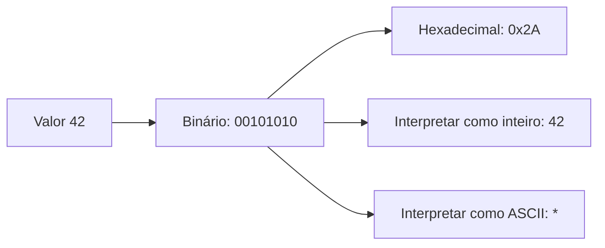

# F01 — Como um computador representa informação

**Pré-requisito:** variáveis, funções e condicionais. **Tempo sugerido:** 45–75 minutos. **Sem eletrônica prévia.**

## Mapa visual do conceito



**Como ler:** siga as setas para identificar entradas, transformações e saídas. Este é um modelo didático, não um diagrama elétrico nem uma prova de temporização.

## Uma pergunta antes da teoria
Você escreveu `idade = 42`. Como um computador distingue o número 42 da letra 'B' se ambos são armazenados em memória? Ele **não distingue sozinho**: a interpretação depende das regras e instruções usadas pelo programa.

## Bit: uma escolha entre dois estados
Um **bit** representa um valor 0 ou 1. Isso não significa que o hardware sempre contenha literalmente zero volts ou um volt; significa que usamos dois estados lógicos distinguíveis. Oito bits formam um **byte**. Com oito posições independentes, existem 2⁸ = 256 combinações.

Exemplo: `00101010` representa o número 42 quando interpretado como inteiro binário sem sinal:

| Posição | 7 | 6 | 5 | 4 | 3 | 2 | 1 | 0 |
|---|---|---|---|---|---|---|---|---|
| Peso | 128 | 64 | 32 | 16 | 8 | 4 | 2 | 1 |
| Bit | 0 | 0 | 1 | 0 | 1 | 0 | 1 | 0 |

Somamos os pesos das posições com bit 1: 32 + 8 + 2 = **42**.

## Por que hexadecimal?
Escrever 32 bits em binário é cansativo. **Hexadecimal** usa 16 símbolos (0–9, A–F), de modo que cada dígito representa exatamente quatro bits. `0010 1010` vira `0x2A`: o prefixo `0x` indica base 16. Isso **não muda os bits**: muda a maneira de escrevê-los.

**Exemplo resolvido 1:** `0x1F` = 1 × 16 + 15 = 31. Em binário: `0001 1111`.

**Exemplo resolvido 2 (limite):** o maior inteiro sem sinal de 8 bits é `11111111` = 255. O número 256 requer nove bits. Se uma operação é limitada a oito bits, o comportamento do estouro depende das regras da operação e da linguagem; não presuma que toda linguagem o trata igualmente.

## Texto também é número?
Um arquivo de texto armazena bytes que seguem uma **codificação**. Em ASCII, o caractere `*` é representado pelo valor decimal 42; portanto, o byte `0x2A` pode ser interpretado como número 42 ou como caractere `*`. A codificação UTF-8 usa de um a quatro bytes por ponto de código Unicode; não é correto assumir que todo caractere ocupa um byte.

## Experimento reproduzível
Execute em um terminal com Python 3:

```bash
python3 - <<'PY'
n = 42
print(bin(n), hex(n), format(n, "08b"))
print(bytes([n]).decode("ascii"))
print(len("á".encode("utf-8")))
PY
```

**Antes de executar:** escreva o que espera ver nas três representações do número, qual caractere ASCII será impresso e quantos bytes o último comando contará.

**Interprete:** `bin` e `hex` mostram representações textuais do mesmo valor; `bytes([n])` cria um byte real. O resultado do UTF-8 não autoriza concluir que toda letra acentuada ocupa dois bytes.

## Erros comuns
- Confundir *bit* com *byte* (8 bits por byte).
- Tratar `0x10` como dez: vale dezesseis.
- Achar que um byte contém obrigatoriamente um caractere.
- Confundir representação textual de um número com sua representação binária na memória.

## Exercícios
1. **Recuperação:** converta `00001101` para decimal.
2. **Aplicação:** escreva 200 em hexadecimal e em binário de oito bits.
3. **Limite:** explique por que 300 não cabe em oito bits sem sinal.
4. **Transferência:** se dois programas leem o mesmo byte `0x2A`, por que um pode exibir `42` e outro `*`?

<details>
<summary>Gabarito comentado — só abra depois de tentar</summary>

1. 8 + 4 + 1 = 13.
2. 200 = 12 × 16 + 8 = `0xC8`; em binário `11001000`.
3. O máximo é 2⁸ − 1 = 255.
4. A sequência de bits é a mesma; cada programa escolhe a interpretação (inteiro ou caractere ASCII).
</details>

## Evidência e revisão
**ENG:** experimento executado com saída registrada, não executado nesta revisão (**NOT_RUN**). **LEARN:** explicar, sem consultar, por que `0x2A` pode significar número ou texto (**NOT_RUN**). Revisar em **1 dia**, **7 dias** e **30 dias**.

**Próxima leitura:** [F02 — lógica](F02-LOGICA.md), depois [A01 — NAND](../workbooks/A01.md).
