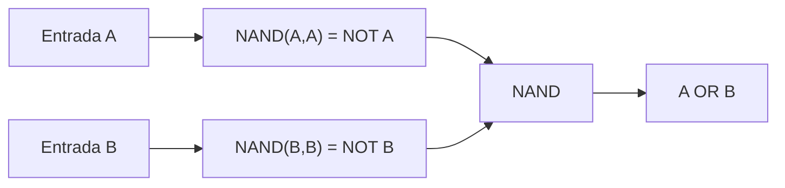

# F02 — Como calcular com verdadeiro e falso

**Pré-requisito:** [F01](F01-BITS-BYTES.md) e condicionais de programação. **Tempo sugerido:** 45–75 minutos.

## Mapa visual do conceito



**Como ler:** siga as setas para identificar entradas, transformações e saídas. Este é um modelo didático, não um diagrama elétrico nem uma prova de temporização.

## Do if ao circuito
Em programação, `if (a && b)` só entra no bloco se as duas condições forem verdadeiras. A lógica digital descreve operações semelhantes, mas sobre sinais binários. **AND** dá 1 apenas se ambas as entradas forem 1. **OR** dá 1 se ao menos uma entrada for 1. **NOT** inverte um bit.

| A | B | AND | OR | XOR | NAND |
|---|---|---|---|---|---|
| 0 | 0 | 0 | 0 | 0 | 1 |
| 0 | 1 | 0 | 1 | 1 | 1 |
| 1 | 0 | 0 | 1 | 1 | 1 |
| 1 | 1 | 1 | 1 | 0 | 0 |

**XOR** é 1 quando as entradas são diferentes. **NAND** é a negação de AND: `NOT(AND(A,B))`.

## O que é uma porta?
Uma **porta lógica** é um componente abstrato com entradas e saída. A tabela descreve *o que* ela deve calcular, não *como* transistores físicos realizam isso. No primeiro contato, não precisamos de conhecimento sobre tensão, corrente ou semicondutores. A diferença entre modelo lógico ideal e circuito físico real será retomada quando for relevante.

## Exemplo resolvido: NOT usando só NAND
Queremos inverter A. Ligue A às duas entradas da NAND:

```text
A ----+---- [ NAND ] ---- saída
      |
      +------------------ (segunda entrada)
```

Como `AND(A,A) = A`, `NAND(A,A) = NOT(A)`.

Se A=0, AND(0,0)=0, NAND=1. Se A=1, AND(1,1)=1, NAND=0. Verificamos **todos** os casos possíveis.

## Exemplo resolvido: OR usando só NAND
Pela lei de De Morgan, `A OR B = NOT(NOT A AND NOT B)`. Substituindo cada NOT por NAND:

```text
na = NAND(A,A)
nb = NAND(B,B)
resultado = NAND(na,nb)
```

Para A=0, B=1: `na=1`, `nb=0`, resultado=1. Para A=0, B=0: `na=1`, `nb=1`, resultado=0.

Isso mostra por que NAND é chamada **funcionalmente completa**: podemos construir NOT, AND e OR a partir dela e, combinando essas operações, implementar qualquer função booleana finita.

## Experimento
Antes de executar, preveja qual linha diferencia OR de XOR.

```bash
python3 - <<'PY'
for a in (0, 1):
    for b in (0, 1):
        nand = 1 - (a & b)
        xor = a ^ b
        print(a, b, nand, xor)
PY
```

Confira os quatro casos com a tabela. O símbolo `^` em Python é XOR bit a bit para inteiros; não significa exponenciação.

## Exercícios
1. **Recuperação:** explique a diferença entre AND e NAND.
2. **Aplicação:** escreva AND usando apenas NAND.
3. **Limite:** qual linha distingue XOR de OR?
4. **Transferência:** implemente em Python uma função `xor_nand(a,b)` usando apenas uma função auxiliar `nand(a,b)`, sem usar `^` ou `or` no cálculo.

<details>
<summary>Gabarito comentado — só abra depois de tentar</summary>

1. NAND inverte a saída de AND.
2. `t=NAND(A,B)`; `AND(A,B)=NAND(t,t)`.
3. A=1, B=1: OR=1 e XOR=0.
4. `t=NAND(a,b)`; `u=NAND(a,t)`; `v=NAND(b,t)`; `NAND(u,v)`. Verifique os quatro casos.
</details>

## Evidência e revisão
**ENG:** comparação das quatro linhas com saída registrada (**NOT_RUN**). **LEARN:** reconstruir NOT e OR com NAND sem consultar (**NOT_RUN**). Revisar em **1 dia**, **7 dias** e **30 dias**.

**Próxima leitura:** [A01 — laboratório NAND](../workbooks/A01.md).
