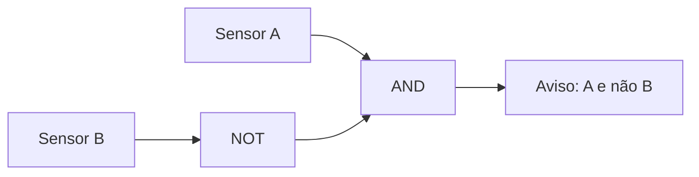

# F03 — Portas, fios e circuitos combinacionais

**Público:** sabe programar, não conhece eletrônica. **Pré-requisito:** [F02-LOGICA ](F02-LOGICA.md). **Tempo sugerido:** 60–100 minutos.

## Mapa visual do conceito

**Como ler:** siga as setas para identificar entradas, transformações e saídas. Este é um modelo didático, não um diagrama elétrico nem uma prova de temporização.

## 1. Problema concreto
Uma porta recebe sinais binários e calcula uma saída. Um circuito combinacional conecta portas; suas saídas dependem das entradas atuais, não de um histórico guardado.

## 2. Conceitos construídos passo a passo
Um circuito que acende um aviso quando A=1 e B=0 pode ser descrito por `A AND NOT B`. Construa NOT(B) com `NAND(B,B)` e AND com duas NAND. A ordem das conexões importa para o funcionamento lógico, mas o modelo ideal não descreve atrasos elétricos.

## Analogia com o mundo real
Uma porta lógica funciona como uma regra de acesso a uma sala: duas autorizações (A e B) são necessárias para entrar (AND). NAND inverte a decisão: o aviso fica ligado exceto quando ambas as autorizações estão presentes.

### Onde a analogia deixa de funcionar
Pessoas, portas físicas e sensores podem atrasar, falhar ou interpretar situações ambíguas. Uma porta lógica ideal tem entradas binárias bem definidas; a analogia não explica eletricidade nem atrasos de propagação.

## 3. Exemplo resolvido
Se A=1 e B=0, NOT B=1, então aviso=1. Se B mudar para 1, aviso=0. Liste também os outros dois pares de entrada. Isso é uma tabela-verdade completa.

## 4. Segundo exemplo e caso-limite
Um fio lógico representa uma conexão entre a saída de uma porta e a entrada de outra. No modelo de hardware, não é uma variável Python que muda instantaneamente em todos os pontos. Circuitos reais possuem tensão, corrente e atraso; esta trilha estuda primeiro o comportamento lógico.

## 5. Experimento guiado e leitura do projeto
Escreva uma função Python `aviso(a,b)` e percorra os quatro pares. Compare a tabela com uma composição NAND. Depois abra `hardware/nand2tetris/` e localize os chips combinacionais.

**Antes de executar:** escreva uma previsão específica. **Depois:** registre comando, saída observada, exit code, commit e explicação para qualquer divergência. Nenhum resultado de execução foi verificado nesta revisão editorial.

## 6. Onde o modelo simplifica
Os exemplos são modelos didáticos. Não extrapole automaticamente de Python para comportamento físico, de Hack para x86-64 ou de uma demonstração para segurança de produção. Identifique o que foi observado e o que permanece hipótese.

## 7. Exercícios progressivos
**Recuperação e aplicação:** Diferencie entrada, saída e fio intermediário; desenhe um circuito para `NOT(A AND B)`; explique por que uma tabela completa de dois bits possui quatro linhas.

**Transferência:** Projete um circuito que acenda se exatamente um dos sensores A e B estiver ativo. Qual caso separa XOR de OR?

Orientações de correção — abra depois de tentar

Uma resposta satisfatória define os termos com precisão, apresenta pelo menos um exemplo numérico ou operacional, explicita o caso-limite e distingue a evidência executada de uma previsão. Compare sua solução com as definições e exemplos deste capítulo; se houver dúvida, registre a lacuna e busque revisão independente.

## 8. Evidência e revisão espaçada
**ENG: NOT_RUN** — não há execução de comandos nesta alteração. **LEARN: NOT_RUN** — o estudante ainda não demonstrou entendimento. Revisar sem consulta após **1 dia**, **7 dias** e **30 dias**. Registrar erro inicial, correção e nova tentativa.

[Índice da Trilha 0](../FOUNDATIONS.md)
