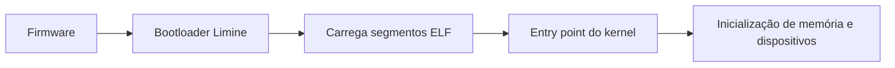

# F07 — Do botão de ligar ao primeiro código do kernel

**Público:** sabe programar, não conhece eletrônica. **Pré-requisito:** [F05-CODIGO-MAQUINA ](F05-CODIGO-MAQUINA.md). **Tempo sugerido:** 60–100 minutos.

## Mapa visual do conceito

**Como ler:** siga as setas para identificar entradas, transformações e saídas. Este é um modelo didático, não um diagrama elétrico nem uma prova de temporização.

## 1. Problema concreto
O processador precisa começar a executar instruções em algum ponto. O firmware inicializa componentes e seleciona um caminho de inicialização; um bootloader prepara o ambiente e transfere o controle para um kernel.

## 2. Conceitos construídos passo a passo
No laboratório x86-64, o Limine é o bootloader. Ele prepara condições necessárias para o kernel, como informações de memória e ambiente de execução. O kernel não começa como um programa comum iniciado pelo Linux: não pode presumir processos, libc ou `printf`.

## Analogia com o mundo real
O firmware se parece com a equipe que abre um teatro, verifica as instalações e indica quem assume a preparação. O bootloader prepara o palco e entrega o controle ao kernel, que passa a organizar o funcionamento durante a apresentação.

### Onde a analogia deixa de funcionar
Não existe uma equipe humana sequencial dentro da CPU; diferentes plataformas têm processos de boot distintos. O bootloader não necessariamente configura todos os dispositivos, e entregar o controle não comprova que o kernel está correto.

## 3. Exemplo resolvido
O kernel é compilado e ligado como executável ELF. Um arquivo ELF contém cabeçalhos e segmentos; segmentos carregáveis indicam quais partes precisam ir para a memória. O entry point informa onde a execução começa, mas um boot bem-sucedido depende também de configuração, protocolo e hardware compatível.

## 4. Segundo exemplo e caso-limite
Exemplo resolvido: `readelf -h kernel.elf` informa arquitetura e entry point; `readelf -l` mostra segmentos. Um ELF válido não prova que o kernel inicializa. Compilar, carregar e executar são etapas distintas e requerem evidências distintas.

## 5. Experimento guiado e leitura do projeto
Leia `scripts/build-kernel.sh` e `kernel/x86_64/linker.ld`. Se houver artefato compilado, execute `readelf -h build/kernel/kernel.elf` e `readelf -l build/kernel/kernel.elf`. Não invente saída quando o arquivo não existir.

**Antes de executar:** escreva uma previsão específica. **Depois:** registre comando, saída observada, exit code, commit e explicação para qualquer divergência. Nenhum resultado de execução foi verificado nesta revisão editorial.

## 6. Onde o modelo simplifica
Os exemplos são modelos didáticos. Não extrapole automaticamente de Python para comportamento físico, de Hack para x86-64 ou de uma demonstração para segurança de produção. Identifique o que foi observado e o que permanece hipótese.

## 7. Exercícios progressivos
**Recuperação e aplicação:** Explique firmware, bootloader, kernel, ELF, segmento carregável e entry point; diga o que `readelf` não consegue comprovar.

**Transferência:** Se o kernel compila mas não imprime no serial do QEMU, quais etapas você investigaria e quais evidências coletaria?

Orientações de correção — abra depois de tentar

Uma resposta satisfatória define os termos com precisão, apresenta pelo menos um exemplo numérico ou operacional, explicita o caso-limite e distingue a evidência executada de uma previsão. Compare sua solução com as definições e exemplos deste capítulo; se houver dúvida, registre a lacuna e busque revisão independente.

## 8. Evidência e revisão espaçada
**ENG: NOT_RUN** — não há execução de comandos nesta alteração. **LEARN: NOT_RUN** — o estudante ainda não demonstrou entendimento. Revisar sem consulta após **1 dia**, **7 dias** e **30 dias**. Registrar erro inicial, correção e nova tentativa.

[Índice da Trilha 0](../FOUNDATIONS.md)
