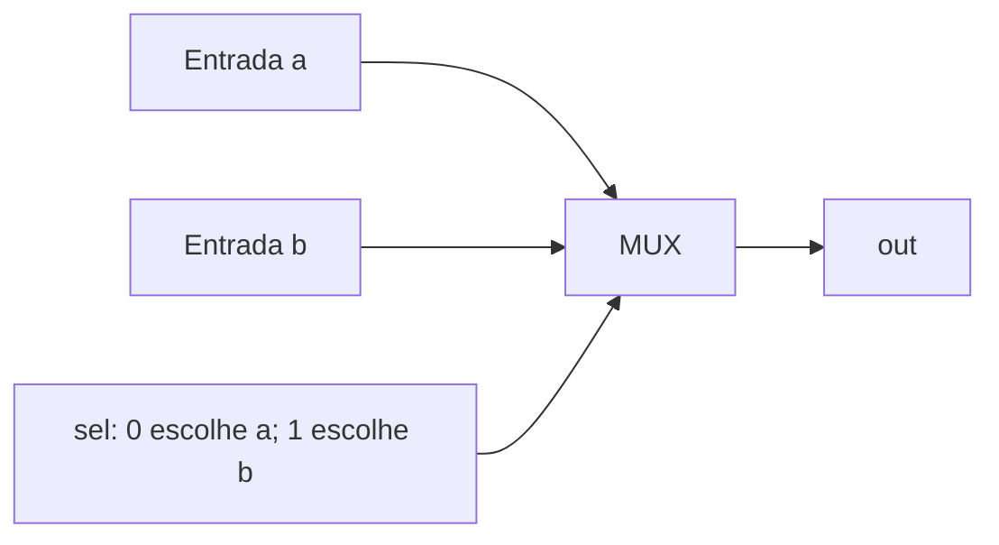

# Workbook A02 — Uma encruzilhada e uma caixa registradora

**Pré-requisitos:** [Trilha 0](../FOUNDATIONS.md), especialmente F02–F05. Este capítulo pressupõe programação básica, não eletrônica.

## Mapa visual do conceito

**Como ler:** siga as setas para identificar entradas, transformações e saídas. Este é um modelo didático, não um diagrama elétrico nem uma prova de temporização.

## Antes do laboratório: duas ideias fundamentais

**Multiplexador (MUX)** é um seletor de sinais: recebe duas entradas de dados `a` e `b`, uma entrada de seleção `sel` e devolve apenas uma delas. Se `sel=0`, devolve `a`; se `sel=1`, devolve `b`. Não soma nem mistura as entradas.

**Exemplo resolvido:** `a=1, b=0, sel=0` produz 1; mudando somente `sel` para 1, produz 0. Na expressão `(a AND NOT sel) OR (b AND sel)`, um dos termos é necessariamente zero.

| a | b | sel | saída |
|---|---|---|---|
| 0 | 1 | 0 | 0 |
| 0 | 1 | 1 | 1 |
| 1 | 0 | 0 | 1 |
| 1 | 0 | 1 | 0 |

**Analogia adicional:** uma torneira misturadora não é um bom modelo de MUX, pois mistura fluxos. Pense em uma chave que conecta um de dois microfones a uma caixa de som: só um sinal é escolhido. **Limite:** em circuitos reais há atrasos e possíveis transições temporárias; o modelo lógico ideal não as representa.

**Meio somador (HalfAdder)** recebe dois bits. Devolve **sum** (bit menos significativo) e **carry** (vai-um). `sum = XOR(a,b)` e `carry = AND(a,b)`. Para 1+1, a soma binária é 10: `sum=0`, `carry=1`.

**Somador completo (FullAdder)** recebe também `carryIn`. Exemplo resolvido: 1+1+1=3 decimal=11 binário; portanto `sum=1`, `carryOut=1`. Pode ser construído com dois meios somadores: `s1=a XOR b`, `c1=a AND b`, `sum=s1 XOR carryIn`, `c2=s1 AND carryIn`, `carryOut=c1 OR c2`.

**Erros comuns:** confundir MUX com OR; confundir carry com resultado; esquecer que o FullAdder recebe três bits, não dois.

**Experimento sem HDL:** execute `python3 -c 'from itertools import product; print([(a,b,s,b if s else a) for a,b,s in product((0,1),repeat=3)])'` e confira as oito combinações. A saída esperada deve ser prevista antes da execução. O teste Python **não substitui** a simulação HDL.

## Fenômeno 1: escolher um caminho
Dois sensores enviam A e B. Um seletor S decide **qual sinal** chega à saída.

**Analogia:** um operador ferroviário direciona um trem entre dois trilhos.

**Onde falha:** um multiplexador não transporta objetos; combina níveis lógicos. Também possui atrasos de propagação.

### Preveja
Complete todas as oito linhas de A, B e S antes de ler `Mux.cmp`. Explique por que `out = (A AND NOT S) OR (B AND S)`.

### Faça
Desenhe a rede com NAND, confira `Mux.hdl` e rode o verificador offline (`python3 tools/verify_hdl.py Mux`). Em seguida, quando disponível, execute o simulador oficial.

## Fenômeno 2: 1 + 1 = 10
Somar dois bits pode produzir dois bits de resultado: soma e transporte.

**Analogia:** na conta decimal, o vai-um passa para a próxima coluna.

**Onde falha:** carry e overflow de inteiro com sinal são conceitos diferentes.

### Preveja
Calcule a tabela de `HalfAdder` e depois de `FullAdder` com entrada carry `c`.

### Faça
Inspecione os HDL e seus arquivos de teste. Use `make test` para validar **somente os modelos aritméticos Python**. Para comprovar as conexões HDL, execute os testes oficiais `.tst`.

## Refute
- Troque `sel` por `NOT sel`: qual caso deve falhar?
- Troque `XOR` por `OR` na soma: qual caso denuncia o erro?
- Remova o carry-in do FullAdder: qual caso denuncia a falha?

## Transferência
Desenhe um seletor de quatro entradas usando três MUX de duas entradas. Explique o custo de profundidade do circuito.

## Evidências
Registre commit, ambiente, hipótese, comandos, stdout, exit code e uma explicação sem analogias.

**Estado:** modelos de referência Python independentes; HDL: simulador oficial PASS na CI (job `hardware-simulator`, run 42429996468, `main` @ 4f4b94d); o gate LEARN continua aberto até o registro do estudante.
