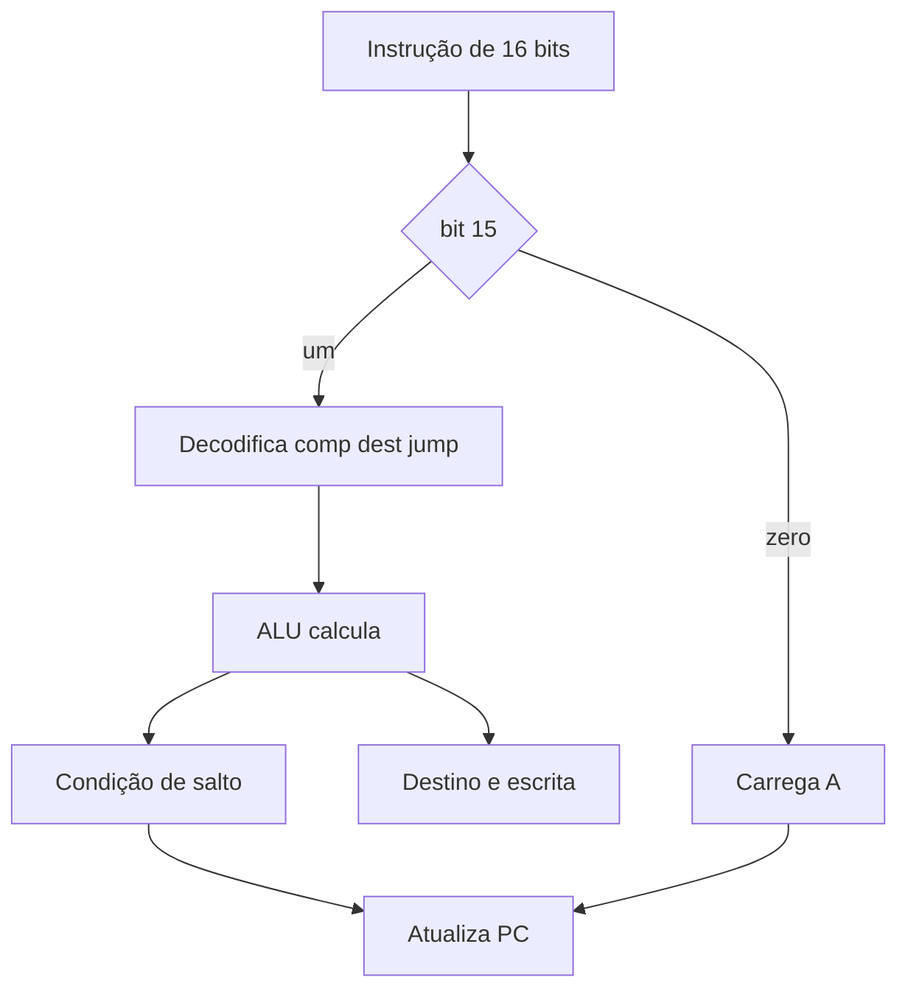

# A05 — A CPU Hack: de circuitos a instruções


**Pré-requisitos:** [Trilha 0](../FOUNDATIONS.md), especialmente F02–F05. Este capítulo pressupõe programação básica, não eletrônica.

## Mapa visual do conceito



**Leitura:** acompanhe as setas; o desenho abstrai detalhes elétricos e temporais.

## Fundamento: interpretar uma instrução é controlar circuitos

A CPU Hack recebe uma instrução de 16 bits. O bit mais significativo distingue a **instrução A** (começa com 0) da **instrução C** (começa com 1). A instrução A carrega um valor no registrador A; a instrução C escolhe cálculo, destinos e salto.

**Analogia:** um formulário de entrega tem campos de “o que fazer”, “onde guardar” e “para onde ir depois”. **Limite:** a CPU não lê palavras; os campos binários acionam diretamente a ALU, os registradores e a lógica do PC.

**Exemplo resolvido:**
```asm
@7
D=A
@5
D=D+A
```
Depois de `@7`, A=7. `D=A` grava D=7. `@5` muda A para 5 sem mudar D. `D=D+A` produz D=12. A memória RAM não precisa ser escrita nesse exemplo.

**Salto:** `@10` seguido de `0;JMP` carrega no PC o endereço 10. Já `D;JGT` só salta se o valor interpretado de D for maior que zero. Para D=0, não salta; para D=1, salta; para D=-1, não salta.

**Experimento independente:** escreva uma tabela com A, D e PC após cada instrução do exemplo, antes de ler `CPU.hdl`. Compare a lógica de seleção de instrução e destino. Execute os testes oficiais apenas em ambiente com simulador configurado; o resultado de um modelo Python não comprova automaticamente o HDL.

**Erros comuns:** supor que `@7` coloca 7 em D; confundir registrador A com a RAM apontada por A; interpretar `writeM` como uma RAM interna da CPU.


## Problema
Como uma sequência de 16 bits decide se a CPU deve guardar um número, calcular, escrever na memória ou saltar?

**Analogia:** uma central de triagem recebe um cartão com campos que determinam o destino e a operação.

**Limite:** a CPU não “lê” um cartão semanticamente; bits controlam diretamente multiplexadores, registradores, ALU e PC.

## Preveja
- `@7` carrega A com 7 e incrementa PC.
- `D=A` copia o valor de A para D.
- `@5`, seguido de `D=D+A`, produz D=12.
- `0;JMP` carrega no PC o endereço que A guardava **antes** da borda do clock.
- Uma instrução A nunca deve ativar `writeM`.

## Experimente
1. Leia `CPU.hdl` e identifique `instruction[15]` (A ou C).
2. Identifique `a`, `comp`, `dest` e `jump` no formato C.
3. Rode `python3 -m unittest discover -s tests -v` para validar o modelo Python de referência.
4. Rode `bash scripts/test-hdl.sh` com o simulador oficial e compare os vetores CPU.

## Refute
Altere a condição `JGT` para sempre saltar. O teste `0;JGT` deve denunciar a falha.

## Transferência
Explique por que o endereço de salto vem do registrador A e por que a escrita em M é um sinal de saída para a memória externa, não uma RAM dentro da CPU.

## Evidência
O modelo Python não prova a correção do HDL. ENG, SCI e LEARN são gates distintos. Estado: simulador oficial PASS na CI (job `hardware-simulator`, run 42429996468, `main` @ 4f4b94d); o gate LEARN continua aberto até o registro do estudante.
