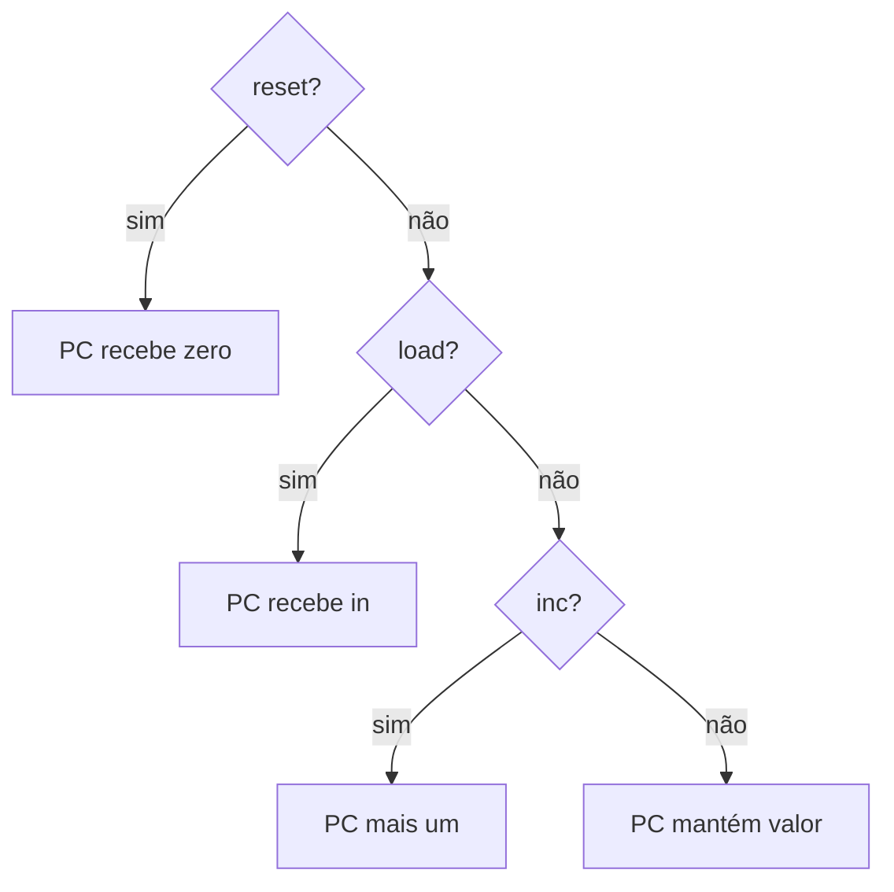

# A05 — O contador de programa: qual instrução vem depois?


**Pré-requisitos:** [Trilha 0](../FOUNDATIONS.md), especialmente F02–F05. Este capítulo pressupõe programação básica, não eletrônica.

## Mapa visual do conceito



**Leitura:** acompanhe as setas; o desenho abstrai detalhes elétricos e temporais.

## Fundamento: um endereço que muda a cada instrução

O **contador de programa** (PC) é um registrador especial que aponta para a instrução a ser buscada. Na CPU Hack, a próxima atualização do PC pode conservar o valor, incrementá-lo, carregar um endereço ou zerá-lo. A prioridade contratual é `reset > load > inc > hold`.

**Analogia:** um marcador de página indica onde continuar um livro; uma indicação de “vá para a página 20” representa um salto. **Limite:** o PC não interpreta linguagem natural; controla endereços de instrução e muda segundo sinais de hardware.

**Exemplo resolvido:** PC começa em 0. Se `inc=1`, após o clock vale 1. Se em seguida `load=1` e `in=99`, vale 99, mesmo que `inc=1`. Se `reset=1`, volta a zero, independentemente dos outros controles.

| PC antes | reset | load | inc | in | PC depois |
|---|---|---|---|---|---|
| 0 | 0 | 0 | 1 | 99 | 1 |
| 1 | 0 | 1 | 1 | 99 | 99 |
| 99 | 1 | 1 | 1 | 50 | 0 |
| 0 | 0 | 0 | 0 | 50 | 0 |

**Experimento independente:**
```bash
python3 - <<'PY'
pc=0
for reset,load,inc,value in [(0,0,1,99),(0,1,1,99),(1,1,1,50),(0,0,0,50)]:
    pc=0 if reset else value if load else (pc+1)&0xffff if inc else pc
    print(pc)
PY
```
Preveja 1, 99, 0, 0 antes de executar. **Erro comum:** achar que `inc` vence `load`, ou que o PC guarda o valor da instrução em vez do endereço.


## Fenômeno

Uma CPU precisa guardar o endereço da próxima instrução. Em execução sequencial, esse endereço avança; em um salto, muda para outro valor; após reset, volta a zero.

**Analogia:** o marcador de página de um livro indica onde continuar a leitura.

**Limite:** o PC guarda um endereço binário, não interpreta páginas. O clock define quando o valor muda. Saltos podem substituir a sequência.

## Preveja antes de executar

Considere o PC inicialmente em zero. Preencha os resultados de cada ciclo:

| in | load | inc | reset | PC após o clock |
|---|---|---|---|---|
| 99 | 0 | 0 | 0 | ? |
| 99 | 0 | 1 | 0 | ? |
| 0x1234 | 1 | 1 | 0 | ? |
| 0 | 0 | 1 | 0 | ? |
| 0x9999 | 1 | 1 | 1 | ? |

Prioridade contratual: **reset > load > inc > hold**.

## Experimento

1. Leia `Inc16.hdl` e `PC.hdl`.
2. Execute `python3 -m unittest discover -s tests -v` para a referência Python.
3. Com o HardwareSimulator oficial instalado, execute `bash scripts/test-hdl.sh` e examine `PC.out`.
4. Compare as previsões com os resultados observados; registre o commit e os comandos.

## Refute

Troque a prioridade de `load` e `inc`. O caso em que ambos valem 1 deve revelar o erro.

## Transferência

Explique como um salto condicional na CPU pode definir `load=1` e fornecer o endereço de destino em `in`.

## Gates

ENG: implementação e testes oficiais. SCI: previsão e controle negativo. LEARN: explicar atualização por clock e prioridades sem analogia. Estado: simulador oficial PASS na CI (job `hardware-simulator`, run 42429996468, `main` @ 4f4b94d); o gate LEARN continua aberto até o registro do estudante.
