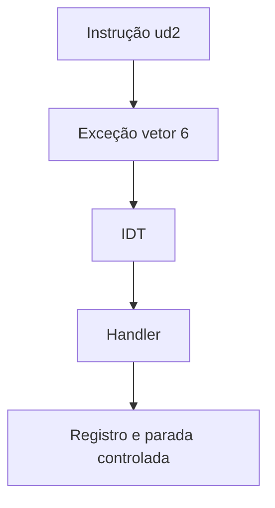

# B03 — GDT, IDT e exceção #UD: observe, preveja, construa e refute

**Não consulte o gabarito antes de tentar.**

## Guia de fundamentos — leitura antes do PACTO

**Pré-requisitos:** [Trilha 0](../FOUNDATIONS.md), especialmente F04–F08; não exige eletrônica prévia. **Objetivo:** explicar o mecanismo antes de pedir previsões avançadas.

### Analogia do cotidiano
Uma central de emergências tem um catálogo que associa ocorrências a equipes. A IDT associa vetores de interrupção/exceção a handlers.

**Onde a analogia falha:** A CPU não telefona nem aguarda; a entrega da exceção segue regras arquiteturais de privilégio, pilha e estado. Uma entrada inválida pode desencadear falhas adicionais.

### Mecanismo, passo a passo
A GDT fornece descritores e seletores de segmento; no modo longo, a segmentação convencional de endereços é limitada, mas seletores e privilégios continuam relevantes.

### Exemplo resolvido
A instrução `ud2` gera #UD (vetor 6). A IDT indica o handler; o stub em assembly preserva estado e o código decide como tratar a falha.

### Caso-limite e erro comum
Sem gate válido para #UD, a entrega pode gerar #GP; falhas aninhadas podem levar a double fault e reset. Isso não é uma estratégia de recuperação.

### Diagrama de fluxo

O diagrama mostra relações conceituais; não comprova temporização, privilégios ou execução real.

### Exercícios graduados
1. **Recuperação:** Explique vetor, handler, IDT, GDT e `iretq`. Por que #PF traz código de erro e #UD não?
2. **Aplicação:** desenhe o fluxo do diagrama e anote o papel de cada etapa sem usar a analogia.
3. **Transferência:** Desenhe o caminho de uma exceção de usuário que pode ser contida e de uma exceção fatal do kernel.

### Orientação de correção
Uma resposta adequada deve nomear as estruturas técnicas, justificar cada transição e apresentar um contraexemplo. Compare sua solução com os exemplos e o código citado no laboratório; registre dúvidas em vez de declarar compreensão sem evidência.

**Estado desta ampliação:** conteúdo editorial implementado; execução dos exemplos, teste com estudante iniciante e revisão independente **NOT_RUN**. As evidências históricas citadas no workbook original pertencem aos commits e ambientes ali identificados, não a esta alteração.

## 1. Fenômeno
A CPU encontra uma instrução que não existe (`ud2`). Ela não pode "ignorar e seguir". Como ela transfere o controle para o kernel?

## 2. Previsão (preencher antes de executar)
- O que acontece se `ud2` executar sem nenhuma entrada na IDT para o vetor 6?
- Por que o kernel carrega a IDT **antes** de trocar a GDT?
- O que significam o seletor `0x28` e o atributo `0x8e` em `set_gate`?
- Por que o handler termina em `cli; hlt` em vez de `iretq`?

## 3. Analogia
A IDT é a lista de ramais de emergência: para cada tipo de problema (vetor), um número a chamar (endereço do handler).

## 4. Onde a analogia falha
A CPU não "liga e espera": ela troca de pilha e de segmento, empilha estado e salta na mesma instrução. Se o ramal não existir, não há tom de ocupado: a entrega falha e gera #GP, depois double fault e, por fim, triple fault (reset).

## 5. Faça
1. Leia `kernel/x86_64/interrupts.c` e `interrupts.S`.
2. Rode o boot normal e a variante com `KERNEL_CFLAGS=-DB03_TRIGGER_UD2` e `B03_EXPECT_UD2=1`.
3. Confirme no `serial.log` que `KERNEL_READY` aparece antes de `EXCEPTION_UD_VECTOR_6`.

## 6. Refute
Remova o `set_gate(6, ...)` numa cópia: o marcador da exceção deve desaparecer, o `qemu-debug.log` deve mostrar o reset, e o gate deve falhar.

## 7. Explique sem analogia
Explique o papel da GDT em modo longo (seletores e níveis de privilégio, sem segmentação de endereços) e o que a CPU faz ao entregar uma exceção sem código de erro.

## 8. Transfira
O vetor 14 (#PF) empilha um código de erro e o vetor 6 não. O que muda no stub em assembly? Compare com `isr_page_fault`, criado no B06.

## 9. Revisão
Sem consulta, refaça as previsões da seção 2 após 1 dia, 7 dias e 30 dias. Registre data e acertos no seu diário.

## 10. Evidência e limites
Gate ENG: a variante `#UD` imprime `PASS` local e na CI. Este marco cobre só a exceção #UD; o tratamento de #PF chegou no B06. IST/TSS, demais vetores e recuperação de exceções são trabalho futuro. A rotina de exceção para a CPU deliberadamente.

Gabarito parcial — abra somente após tentar

- Sem entrada para o vetor 6: observado no QEMU 8.2.2 (`qemu-debug.log`, 2026-11-08): `new 0x6` → `new 0xd` (#GP, gate inválido) → #GP de novo → `0x8` (double fault, também sem entrada) → `Triple fault`: a máquina reinicia. É comportamento emulado; em hardware real, confira no Intel SDM vol. 3, cap. 6.
- IDT antes da GDT: se a troca de segmentos falhar, a falha ainda tem onde ser entregue (a IDT precisa existir).
- `0x28` é o seletor do código de 64 bits na GDT; `0x8e` = presente, DPL 0, interrupt gate de 64 bits (desliga IF).
- `cli; hlt`: ainda não há como corrigir a causa; retornar executaria `ud2` de novo, em laço.
- Transferência: o stub lê o código de erro do topo da pilha e, para retornar com `iretq`, precisaria descartá-lo antes.

