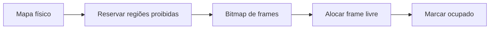

# B05 — Alocador de frames físicos: observe, preveja, construa e refute

**Não consulte o gabarito antes de tentar.**

## Guia de fundamentos — leitura antes do PACTO

**Pré-requisitos:** [Trilha 0](../FOUNDATIONS.md), especialmente F04–F08; não exige eletrônica prévia. **Objetivo:** explicar o mecanismo antes de pedir previsões avançadas.

### Analogia do cotidiano
Um estacionamento possui vagas numeradas; algumas estão bloqueadas para manutenção. O alocador entrega somente vagas livres e marca cada uma como ocupada.

**Onde a analogia falha:** Frames são blocos de bytes, não vagas reais; mapas de memória têm regiões sobrepostas, alinhamento e restrições de firmware. Reservar não equivale a inicializar os bytes.

### Mecanismo, passo a passo
Um bitmap pode representar o estado de cada frame: bit 1 ocupado/reservado, bit 0 livre, conforme a convenção adotada. Uma alocação marca o bit antes de devolver o endereço.

### Exemplo resolvido
Um frame de 4 KiB tem 4096 bytes. Para uma região [0x1800,0x4800), os frames completos começam em 0x2000 e 0x3000; as bordas parciais não devem ser entregues.

### Caso-limite e erro comum
Alocar o mesmo frame duas vezes permite corrupção entre consumidores. Um double free pode liberar memória que já foi reutilizada por outro componente.

### Diagrama de fluxo

O diagrama mostra relações conceituais; não comprova temporização, privilégios ou execução real.

### Exercícios graduados
1. **Recuperação:** Por que o mapa do bootloader não pode ser tratado como 'toda RAM livre'? Como alinhar limites sem invadir regiões reservadas?
2. **Aplicação:** desenhe o fluxo do diagrama e anote o papel de cada etapa sem usar a analogia.
3. **Transferência:** Projete uma sequência alocar/liberar/alocar e um teste negativo que detecte devolução duplicada.

### Orientação de correção
Uma resposta adequada deve nomear as estruturas técnicas, justificar cada transição e apresentar um contraexemplo. Compare sua solução com os exemplos e o código citado no laboratório; registre dúvidas em vez de declarar compreensão sem evidência.

**Estado desta ampliação:** conteúdo editorial implementado; execução dos exemplos, teste com estudante iniciante e revisão independente **NOT_RUN**. As evidências históricas citadas no workbook original pertencem aos commits e ambientes ali identificados, não a esta alteração.

## 1. Fenômeno
A máquina tem 128 MiB de RAM, mas parte dela é do firmware, do kernel e do próprio bootloader. Como o kernel descobre quais páginas físicas de 4 KiB pode usar e entrega cada uma uma única vez?

## 2. Previsão (preencher antes de executar)
- Por que o PMM nunca entrega o frame físico 0, e o que quebraria se entregasse?
- Quantos bytes ocupa um bitmap que cobre 4 GiB em frames de 4 KiB?
- Uma região usável começa em `0x1800` e tem `0x3000` bytes. Quais frames inteiros ela contém?
- Para que serve o bitmap `owned`, além de `used`?

## 3. Analogia
O PMM é o guarda-volumes de uma rodoviária: um quadro com um pino por armário, livre ou ocupado, e só se devolve o armário com o tíquete certo.

## 4. Onde a analogia falha
O "quadro" (bitmap) mora na própria memória que ele controla, e os armários não estão vazios ao serem entregues: o conteúdo antigo continua lá até alguém zerar. Também não há "tíquete": a devolução é validada só pelo endereço.

## 5. Faça
1. Leia `kernel/x86_64/pmm.c` e o trecho B05 de `kmain`.
2. Rode `make test-kernel-boot` e confira `B05_PMM_ALLOC_FREE_OK`.
3. Calcule à mão o tamanho de `used` e `owned` e confirme com `nm -S build/kernel/kernel.elf`.

## 6. Refute
- Remova a checagem de `owned` em `pmm_free` numa cópia: qual teste de `kmain` deveria falhar? Ele falha?
- Faça `pmm_init` liberar também regiões não usáveis: preveja o que acontece no boot.

## 7. Explique sem analogia
Explique o arredondamento de início (para cima) e de fim (para baixo) das regiões, o cursor de próxima busca e por que `UINT64_MAX` sinaliza falta de memória.

## 8. Transfira
O PMM cobre só os primeiros 4 GiB. O que mudaria para cobrir 64 GiB, e quanto custaria o bitmap?

## 9. Revisão
Sem consulta, refaça as previsões da seção 2 após 1 dia, 7 dias e 30 dias. Registre data e acertos no seu diário.

## 10. Evidência e limites
Gate ENG: `B05_PMM_ALLOC_FREE_OK` no boot, local e na CI (aloca dois frames distintos, libera um, rejeita double free). Limites: só frames abaixo de 4 GiB; busca linear; sem zerar páginas; memória "bootloader reclaimable" nunca é devolvida (ainda contém as tabelas de páginas do Limine).

Gabarito parcial — abra somente após tentar

- Frame 0: endereço físico 0 é indistinguível de "nulo" em muitas APIs e, em PCs, contém a tabela de vetores do modo real e dados do BIOS. `pmm_free` também rejeita 0, então os dois lados são consistentes.
- 4 GiB / 4 KiB = 1 Mi frames → 1 Mi bits = 128 KiB por bitmap (256 KiB com `owned`).
- `0x1800`–`0x4800`: os frames inteiros são `0x2000` e `0x3000` (o primeiro e o último parciais ficam fora).
- `owned` distingue "ocupado porque foi alocado" de "ocupado porque nunca foi usável": impede liberar memória do firmware ou do kernel.
- Transferência: 16 Mi frames → 2 MiB por bitmap; aí compensa um bitmap por região ou uma lista de livres.

