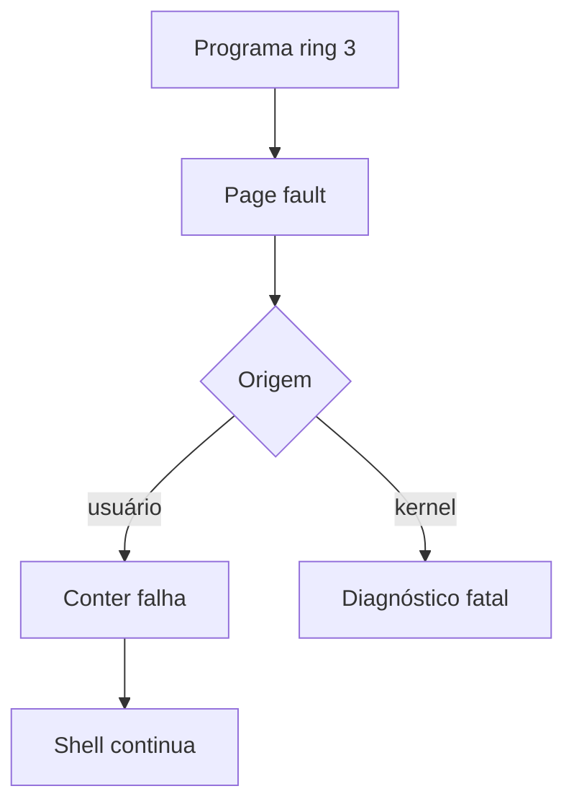

# B12 — Integração e contenção de falhas: observe, preveja, construa e refute

**Não consulte o gabarito antes de tentar.**

## Guia de fundamentos — antes do PACTO

**Pré-requisitos:** [Trilha 0](../FOUNDATIONS.md), especialmente F06–F08. **Objetivo:** compreender o mecanismo antes dos exercícios avançados.

### Analogia real e limites
Um prédio separa apartamentos; o problema de um morador não deveria destruir a estrutura inteira. **Onde falha:** O hardware detecta certas violações, mas o kernel precisa implementar a recuperação. Falhas do próprio kernel podem ser fatais.

### Mecanismo
O seletor CS salvo permite identificar o nível de privilégio anterior. Não é seguro simplesmente repetir a instrução que causou a falha.

### Exemplo resolvido
Uma tentativa inválida de acesso em ring 3 pode gerar #PF. O handler verifica o contexto salvo e pode encerrar somente o programa de usuário.

### Caso-limite
Um marcador de crash não prova recuperação; outro comando precisa funcionar depois.

### Fluxo visual

### Exercícios graduados
1. **Recuperação:** Explique CPL, #PF, handler e contexto salvo.
2. **Aplicação:** reconstrua o fluxo do diagrama sem consultar.
3. **Transferência:** Como provar continuidade após o crash sem depender só do marcador da falha?

### Evidência
**ENG/LEARN desta alteração: NOT_RUN.** As evidências históricas citadas abaixo não validam a revisão pedagógica atual. Registrar previsão, execução, resultado, commit e explicação independente.

## 1. Fenômeno
Um sistema operacional de verdade não pode morrer porque um programa de usuário errou. Como o kernel deixa um programa quebrar (acessar memória que não é dele) e, em vez de travar a máquina, encerra só aquele programa e continua atendendo comandos?

## 2. Previsão (preencher antes de executar)
- Quando um programa de ring 3 acessa um endereço não mapeado, o processador gera `#PF`. Como o kernel descobre que o fault veio de ring 3 e não de si mesmo?
- Por que um `#PF` vindo do próprio kernel (ring 0) deve continuar sendo fatal, enquanto um de ring 3 é contido?
- O que precisa estar salvo para o kernel "voltar" de dentro do handler de interrupção para o ponto onde chamou o programa de usuário?
- Depois de conter o crash, o shell consegue executar o próximo comando?

## 3. Analogia
O kernel é um síndico que deixa cada morador (programa) usar seu apartamento (espaço de endereços), mas tranca as portas dos outros. Se um morador tenta arrombar a porta alheia, o síndico o remove do prédio sem demolir o edifício.

## 4. Onde a analogia falha
O "síndico" é chamado pelo próprio hardware (a exceção), não por vigilância ativa; ele só age quando o arrombamento já disparou o alarme (`#PF`). E "remover o morador" aqui é desenrolar a pilha do kernel de volta a um ponto salvo, não um despejo gradual: é abrupto e imediato.

## 5. Faça
1. Leia o handler `exception_page_fault` (checagem de CPL via `saved_cs`), o stub `isr_page_fault` (passa o CS salvo) e `usermode_fault_return_rsp`/`usermode_return`.
2. Leia o programa `userland/crash.S` e o caminho `run crash` no shell.
3. Rode `make test-kernel-boot` e confirme `B12_CRASH_BEFORE_FAULT`, `B12_CRASH_CONTAINED` e, depois, `B11_SHELL_OK`.

## 6. Refute
- Numa cópia, mude a condição de contenção para nunca valer: o crash derruba o kernel? (Controle negativo verificado: boot falha com "kernel did not contain the ring-3 fault", aparece `EXCEPTION_PF_CR2_` fatal.)
- Faça o próprio kernel ler um endereço inválido: o fault ainda é contido? Deveria?
- Remova o comando `cat` final do script: como você provaria que o shell sobreviveu ao crash?

## 7. Explique sem analogia
Explique sem o síndico: o layout do frame de `#PF` na pilha (error code, RIP, CS, ...), como os 2 bits baixos do CS salvo dão o CPL, e por que `usermode_return` consegue abandonar o frame de interrupção restaurando apenas o `rsp` de kernel salvo em `usermode_run_trampoline`.

## 8. Transfira
Hoje a contenção mata o programa e volta ao shell. Num SO completo, o que mais o kernel faria ao conter um fault (sinal ao processo, código de saída, liberar recursos)? E para faults legítimos (página sob demanda, copy-on-write), como distinguir "erro do programa" de "trabalho normal de paginação"?

## 9. Revisão
Sem consulta, refaça as previsões da seção 2 após 1 dia, 7 dias e 30 dias. Registre data e acertos no seu diário (`docs/journal/B12.md`).

## 10. Evidência e limites
Gate ENG (fecha a "Definição de utilizável" do roadmap): o sistema inicia no QEMU, o shell recebe comandos, executa dois programas de usuário próprios (`hello` e `crash`), lê/grava arquivos persistentes (B10), e contém a falha de um programa sem derrubar o kernel (`B12_CRASH_CONTAINED`, seguido de `B11_SHELL_OK`). Limites: a contenção apenas encerra o programa (sem sinais nem código de saída ao "pai"); só `#PF` de ring 3 é contido (não #GP, #UD etc.); uma única tarefa de usuário por vez; sem reaproveitamento de recursos além de desmapear a pilha.

Gabarito parcial — abra somente após tentar

- Origem do fault: os 2 bits baixos do CS salvo no frame de `#PF` são o CPL; `==3` indica ring 3.
- `#PF` de ring 0 fatal: um fault no próprio kernel é um bug sério (ponteiro inválido, tabela corrompida) sem "processo" para encerrar; mascará-lo esconderia a causa.
- Para voltar: o `rsp` de kernel salvo por `usermode_run_trampoline` antes de entrar em ring 3; `usermode_return` o restaura e retorna de `usermode_run` com o código de fault.
- Após conter: sim — o shell executa `cat greeting.txt` de novo e emite a saída, provando sobrevivência.

